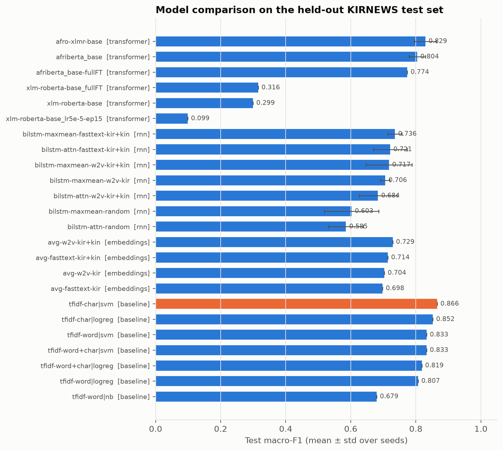

# Kirundi News Topic Classification

Text classification for **Kirundi** (Ikirundi, ISO 639-3 `run`), a Bantu language spoken by about
11 million people and an official language of Burundi. Given a Kirundi news article, the system predicts
one of 10 topics: politics, sport, economy, health, education, entertainment, relationship,
technology, environment, culture.

## Project links
| | |
|---|---|
| **Live system** | https://huggingface.co/spaces/ReneNtabana/kirundi-news-classifier (runs in your browser; first load downloads ~280 MB) |
| **Fine-tuned model** | https://huggingface.co/ReneNtabana/kirundi-news-classifier |
| **Demo video** | _TBD_ |
| **Report (PDF)** | [`report/report.pdf`](report/report.pdf) |

## Summary
* The official KIRNEWS split **leaks its entire test set into training**. We rebuilt a clean split (1,742 articles, 10 classes).
* **Final model: AfroXLMR-base**, test accuracy **0.910 ± 0.012**, macro-F1 **0.829 ± 0.034** (3 seeds). Out-of-distribution
  (BBC Gahuza, MasakhaNEWS): **0.872** accuracy, vs. 0.80 for the best TF-IDF model.
* A char-n-gram SVM is just as strong in-domain, and **adding Kinyarwanda training data** gives the best in-domain macro-F1 (0.888).
* XLM-R, which has the same architecture but no African-language pre-training, fails under the same budget (macro-F1 0.30).
* The model is over-confident and cannot reject unseen topics. The app flags predictions below 0.9 confidence.

## Problem and motivation
Kirundi has very few NLP resources. Before this project it had a single public labelled topic
dataset, KIRNEWS (Niyongabo et al., 2020), and a small Kirundi section in MasakhaNEWS (Adelani et al., 2023).
Automatic topic classification is a basic building block for news aggregation, content moderation
and information access in the language. The project compares classical, recurrent and pretrained
Transformer approaches and studies **how much data quality, related-language data (Kinyarwanda)
and African-centric pretraining** matter in a low-resource setting.

## Dataset
* **Source:** KIRNEWS, `kirnews_raw` (Niyongabo et al., 2020; MIT licence), from 8 Burundian news websites,
  obtained from the Hugging Face Hub (`andreniyongabo/kinnews_kirnews`).
* **Audit (our finding):** the official split leaks. **All 923 test articles also occur in the
  training set**, and 2,801 of the 4,612 rows are duplicates. We pooled train+test and then:
  1. de-duplicated on normalised text (exact) and with char-n-gram TF-IDF cosine > 0.9 (near-duplicates);
  2. dropped 35 articles that appear with conflicting labels;
  3. dropped classes with fewer than 25 unique articles (history: 9, religion: 17);
  4. stripped web boilerplate (share widgets, e-mails, phone numbers);
  5. built a stratified **70/15/15** split (seed 42): **1,219 / 261 / 262** articles, 10 classes.
* **Extra data:** 11,070 unique Kinyarwanda articles from KINNEWS (used only for word-embedding
  pre-training); **MasakhaNEWS-run** (1,525 BBC Gahuza articles, 5 overlapping classes) used only as an
  **out-of-distribution test set**.
* No synthetic or LLM-generated data is used for training.

Details: [`results/data_stats.json`](results/data_stats.json), EDA figures in [`results/figures/`](results/figures/).

## Methods
| Family | Models | Code |
|---|---|---|
| Baselines | majority class; TF-IDF (word / char / word+char n-grams) + Naive Bayes / Logistic Regression / Linear SVM | [`src/baselines.py`](src/baselines.py) |
| Static embeddings | Word2Vec & FastText (skip-gram, 200-d) trained on Kirundi or Kirundi+Kinyarwanda; mean-pooled + LogReg | [`src/embeddings.py`](src/embeddings.py) |
| RNN | BiLSTM with max+mean or additive-attention pooling; random vs pretrained embedding init | [`src/lstm.py`](src/lstm.py) |
| Transformers | Fine-tuned AfriBERTa-base, AfroXLMR-base, XLM-R-base (class-weighted loss, frozen word embeddings) | [`src/finetune.py`](src/finetune.py) |
| Cross-lingual | Kinyarwanda→Kirundi zero-shot and augmented training; OOD test on MasakhaNEWS | [`src/crosslingual.py`](src/crosslingual.py), [`src/ood.py`](src/ood.py) |

Model selection always uses the validation set. The test set is used once per final configuration.
The primary metric is **macro-F1** because of the 24:1 class imbalance. Multi-seed results report mean ± std.

## Results
Held-out KIRNEWS test set (262 articles) and out-of-distribution MasakhaNEWS-run (1,525 articles, 5 classes).
Mean ± std over 3 seeds where shown. Full table: [`results/summary_table.md`](results/summary_table.md).

| Model | Test accuracy | Test macro-F1 | OOD accuracy | OOD macro-F1 |
|---|---|---|---|---|
| Majority class | 0.351 | 0.052 | – | – |
| TF-IDF word+char + SVM (val-selected) | 0.908 | 0.833 | 0.800 | 0.721 |
| TF-IDF char + SVM | 0.912 | 0.866 | 0.803 | 0.729 |
| TF-IDF char + SVM, + Kinyarwanda training data | 0.912 | **0.888** | 0.815 | 0.758 |
| Avg. Word2Vec (kir+kin) + LogReg | 0.840 | 0.729 | – | – |
| BiLSTM, random init | 0.785 ± 0.025 | 0.603 ± 0.084 | – | – |
| BiLSTM, FastText (kir+kin) init | 0.859 ± 0.019 | 0.736 ± 0.021 | – | – |
| XLM-R-base | 0.569 | 0.299 | 0.466 | 0.350 |
| AfriBERTa-base | 0.893 ± 0.014 | 0.804 ± 0.025 | 0.830 | 0.753 |
| **AfroXLMR-base (deployed)** | **0.910 ± 0.012** | 0.829 ± 0.034 | **0.872** | **0.799** |



The error analysis (confusions, label noise, source confounds, calibration, unseen topics) is in
[`results/error_analysis/`](results/error_analysis/) and Section 7 of the report.

## Repository layout
```
src/
  data.py            download, audit, clean, split KIRNEWS (+ KINNEWS for embeddings)
  eda.py             dataset statistics and figures
  evaluate.py        shared metrics, experiment log (results/experiments.csv), confusion matrices
  baselines.py       majority + TF-IDF linear models (val-tuned, 5-fold CV)
  embeddings.py      Word2Vec / FastText training and probe
  lstm.py            BiLSTM (+attention) classifier in PyTorch
  finetune.py        Hugging Face fine-tuning of pretrained Transformers
  ood.py             out-of-distribution test on MasakhaNEWS-run
  error_analysis.py  misclassifications, confusion pairs, length/OOV/source analysis, unseen inputs
  summarize.py       aggregate results into tables/figures for the report
  crosslingual.py    Kinyarwanda->Kirundi transfer + OOD for all TF-IDF models
  export_onnx.py     int8 ONNX export for the browser app, with verification
  predict.py         inference (CLI and shared by the evaluation scripts)
web/                 deployed web app (static HF Space; transformers.js runs the ONNX model in the browser)
app/                 Gradio version of the app for running the full-precision model locally
scripts/             run helpers
results/             metrics, tables, figures (all numbers in the report come from here)
report/              report source and PDF
tests/               pytest sanity checks (no split leakage, app/train preprocessing identical)
```

## Reproducing
Tested on macOS (Apple M1 Pro, 16 GB, PyTorch MPS) with Python 3.11.
```bash
python3.11 -m venv .venv && source .venv/bin/activate
pip install -r requirements.txt

python -m src.data            # download + clean + split   (~1 min)
python -m src.eda             # figures
python -m src.baselines       # TF-IDF baselines           (~5 min)
python -m src.embeddings      # Word2Vec / FastText        (~20 min)
python -m src.lstm            # BiLSTMs, 3 seeds           (~3 h on CPU)
scripts/run_transformers.sh   # 3 Transformers, seed 42    (~2.5 h on M1 GPU)
scripts/run_extra.sh          # extra seeds + XLM-R ablations
python -m src.ood             # MasakhaNEWS-run OOD test
python -m src.crosslingual    # Kinyarwanda transfer + OOD for TF-IDF models
python -m src.error_analysis --model models/ft-<best>
python -m src.summarize       # tables + comparison figure
python -m src.export_onnx     # ONNX export for the web app
python report/build_pdf.py    # report PDF (needs Google Chrome)
pytest -q
```
Exact package versions: [`requirements-lock.txt`](requirements-lock.txt).

**Run the app locally:** `cd web && python -m http.server 8000` and open http://localhost:8000 (browser version),
or `MODEL_ID=models/ft-afro-xlmr-base python app/app.py` (Gradio, full-precision model).

**Use the model in Python:**
```python
from transformers import pipeline
clf = pipeline("text-classification", model="ReneNtabana/kirundi-news-classifier")
print(clf("intamba mu rugamba yatsinze umukino w'umupira w'amaguru"))
```

## Acknowledgements and licences
* KINNEWS/KIRNEWS: Niyongabo, Hong, Kreutzer & Huang (2020), MIT licence.
* MasakhaNEWS: Adelani et al. (2023), used for evaluation only.
* Pretrained models: AfriBERTa (Ogueji et al., 2021), AfroXLMR (Alabi et al., 2022), XLM-R (Conneau et al., 2020).
* Libraries: scikit-learn, gensim, PyTorch, Hugging Face Transformers/Datasets, Gradio.

Full references are in the report.
